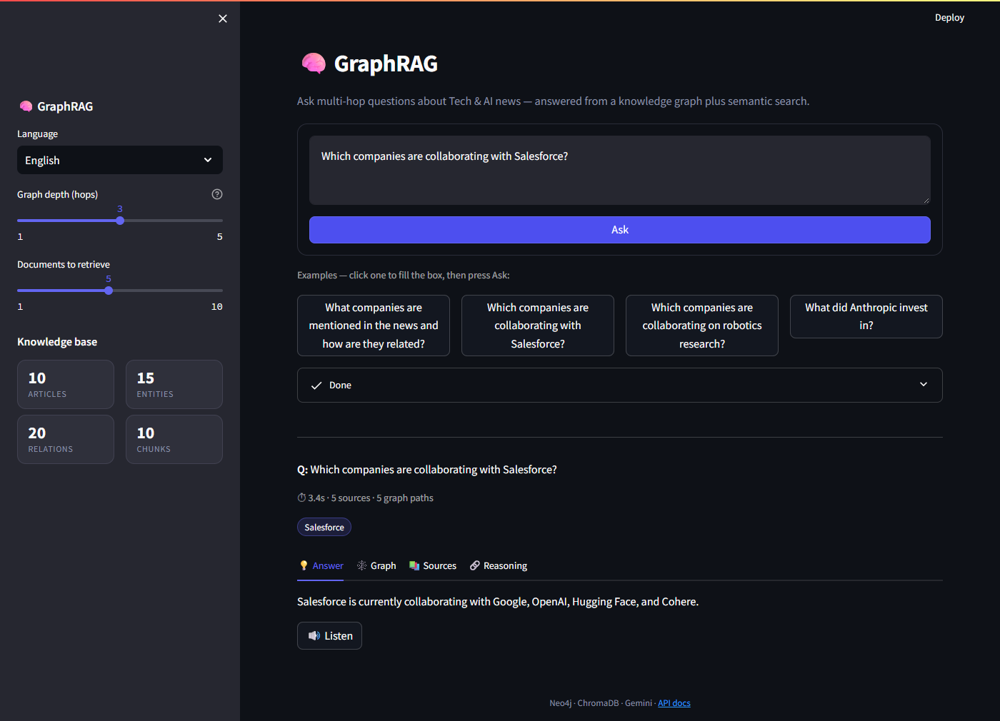
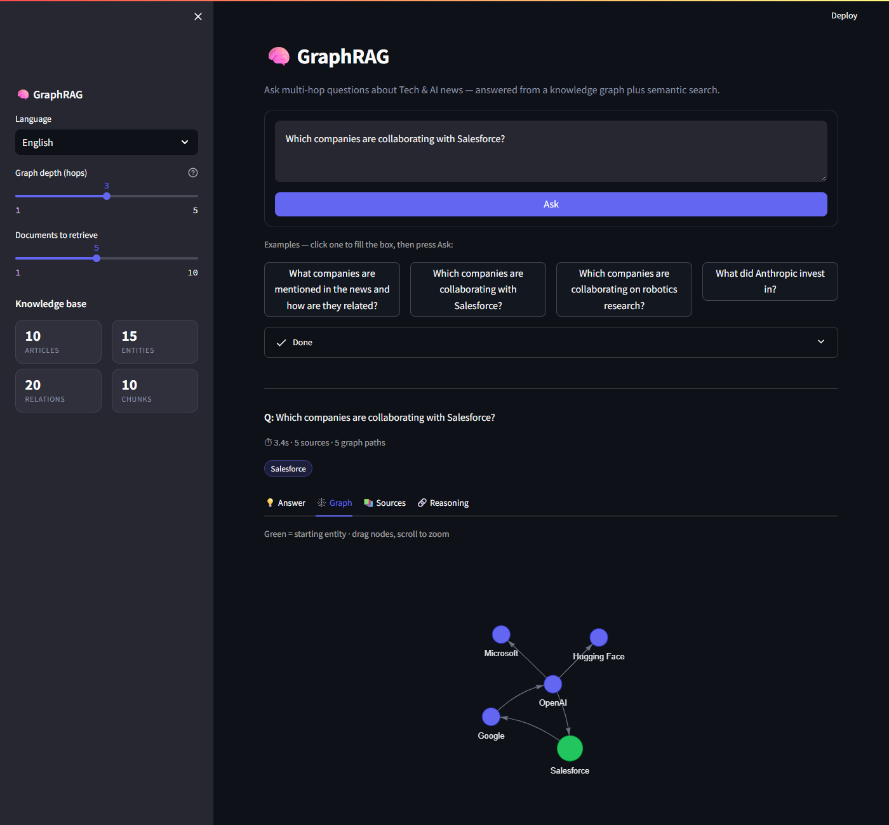

# GraphRAG for Multi-Hop Reasoning

Ask questions whose answers are **spread across several news articles**, and get a grounded answer, its sources, and the **graph path** that connects the facts.

GraphRAG combines a **knowledge graph (Neo4j)** with **vector search (ChromaDB)** and an LLM (**Google Gemini**) so that facts from different documents can be chained together, which plain RAG cannot do.

| Answer | Graph path |
|---|---|
|  |  |

---

## The problem

Standard RAG retrieves text chunks that are *similar* to the question. It breaks when the answer needs facts joined from different documents:

- Article 1: *Google collaborated with Salesforce.*
- Article 2: *Salesforce collaborated with Hugging Face.*
- Question: *How is Google connected to Hugging Face?*

No single chunk says it. As a graph, the answer is a walk of two hops:

```
Google ──COLLABORATED_WITH──▶ Salesforce ──COLLABORATED_WITH──▶ Hugging Face
```

This project builds that graph from raw articles and walks it at query time. Each hop is one step along a relationship, which is why it is called **multi-hop reasoning**.

## How it works

**1. Offline pipeline (run once to build the knowledge base)**

```
News articles (CSV / RSS / NewsAPI / HackerNews)
   │  clean + chunk
   ▼
MongoDB  ← raw articles
   │
   ├─▶ spaCy NER ─▶ Gemini triple extraction ─▶ Neo4j  (entities + relationships)
   └─▶ sentence-transformers embeddings      ─▶ ChromaDB (text chunks as vectors)
```

**2. Online query flow (every time a user asks)**

```
Question
   ├─▶ detect entities (spaCy + match against graph entity names)
   ├─▶ Neo4j: walk the graph from those entities (up to N hops)
   ├─▶ ChromaDB: top-K most similar text chunks
   ▼
Merged context ─▶ Gemini (answer only from this evidence)
   ▼
Answer + sources + reasoning steps + graph path
```

**Why both stores?** The graph shows *how things connect*; the vectors supply *the supporting text*. Together they give answers that are both connected and traceable.

## Tech stack

| Layer | Technology |
|---|---|
| **Frontend** | Streamlit, PyVis (vis.js) for the interactive graph, custom CSS |
| **Backend** | Python 3.11, FastAPI, Uvicorn, Pydantic |
| **Graph database** | **Neo4j 5** (Cypher, APOC) |
| **Vector database** | ChromaDB (cosine similarity) |
| **Document store** | MongoDB 7 |
| **LLM** | Google Gemini (triple extraction + answer generation) |
| **NLP / embeddings** | spaCy `en_core_web_sm`, sentence-transformers `all-MiniLM-L6-v2` (384-d) |
| **Infra** | Docker Compose (MongoDB + Neo4j) |
| **Extras** | APScheduler, deep-translator (multilingual), gTTS (read answers aloud), Loguru, Tenacity |

## Quick start

**Prerequisites:** Python **3.11**, Docker Desktop, and a free [Gemini API key](https://aistudio.google.com/apikey).
Python 3.12+ is not tested with the pinned dependencies (torch, chromadb).

```powershell
# 1. Start the databases
docker compose up -d mongodb neo4j

# 2. Create a virtual environment and install dependencies
python -m venv .venv
.venv\Scripts\Activate.ps1          # macOS/Linux: source .venv/bin/activate
pip install -r requirements.txt
python -m spacy download en_core_web_sm

# 3. Configure environment
copy .env.example .env              # then paste your GEMINI_API_KEY into .env

# 4. Make the project importable (needed for the scripts and Streamlit)
$env:PYTHONPATH = (Get-Location).Path     # macOS/Linux: export PYTHONPATH=$PWD

# 5. Verify everything is connected (expects 6/6 passing)
python test_connections.py

# 6. Build the knowledge base from the sample data
python scripts/run_pipeline.py --dataset ./data/sample_tech_news.csv --limit 10

# 7. Run the API and the UI (two terminals, each with PYTHONPATH set)
uvicorn app.api:app --host 127.0.0.1 --port 8000
streamlit run app/streamlit_app.py --server.port=8501
```

| What | URL |
|---|---|
| App (Streamlit UI) | http://localhost:8501 |
| API docs (Swagger) | http://localhost:8000/docs |
| Neo4j browser | http://localhost:7474 (`neo4j` / `graphrag_password`) |

Try: *"Which companies are collaborating with Salesforce?"*, *"What did Anthropic invest in?"*, *"Which companies are collaborating on robotics research?"*

## Using the app

- **Ask** runs the question in the box. Example buttons only fill the box.
- **Graph depth** controls how many hops are followed in the knowledge graph.
- **Tabs:** Answer, Graph (green node = starting entity), Sources, Reasoning.
- **Knowledge base panel** shows how much data is loaded (articles, entities, relations, chunks).

API example:

```bash
curl -X POST http://localhost:8000/query -H "Content-Type: application/json" \
     -d '{"query": "Which companies are collaborating with Salesforce?"}'
```

## Project structure

```
app/          FastAPI service (api.py) and Streamlit UI (streamlit_app.py)
ingestion/    Fetch and clean articles (CSV, RSS, NewsAPI, HackerNews)
extraction/   spaCy NER and Gemini triple extraction
graph/        Neo4j client and graph builder
vector/       Embeddings and ChromaDB client
retrieval/    Query entity detection, subgraph and vector retrieval
reasoning/    Multi-hop retrieval that merges graph and vector context
generation/   Gemini answer generation and result formatting
scripts/      Pipeline runner, sample-data generator, scheduler
config/       Settings (.env), logging, Pydantic models
data/         Sample tech-news dataset
```

## Configuration

Set in `.env` (see `.env.example`). Common options: `GEMINI_MODEL`, `GRAPH_TRAVERSAL_DEPTH` (default 3), `TOP_K_VECTOR` (default 5), `CHUNK_SIZE`, `GEMINI_MAX_CALLS_PER_RUN`.

## Limitations

- **Small demo dataset:** 10 articles, 15 entities, 20 relationships. Questions outside this data return "not enough information".
- **Extraction quality depends on the LLM.** Missed relationships will be missing from the graph, and entity names are not fully de-duplicated.
- **Free Gemini tier is rate-limited** (a small daily request quota per model), so large ingestions are slow. If you see 429/quota errors, switch `GEMINI_MODEL` to one with remaining quota.
- **Graph paths follow links outward from the matched entities**, so some returned paths can be only loosely related.
- Local prototype: no authentication, and the databases run in local Docker containers.

## Ideas for improvement

- Entity resolution (merge "OpenAI" / "Open AI" / "OpenAI Inc.").
- Rank paths by relevance to the question, and label edges in the graph view.
- Build an evaluation set to benchmark multi-hop accuracy against plain RAG.
- Containerise the app and add a job queue for large-scale ingestion.
