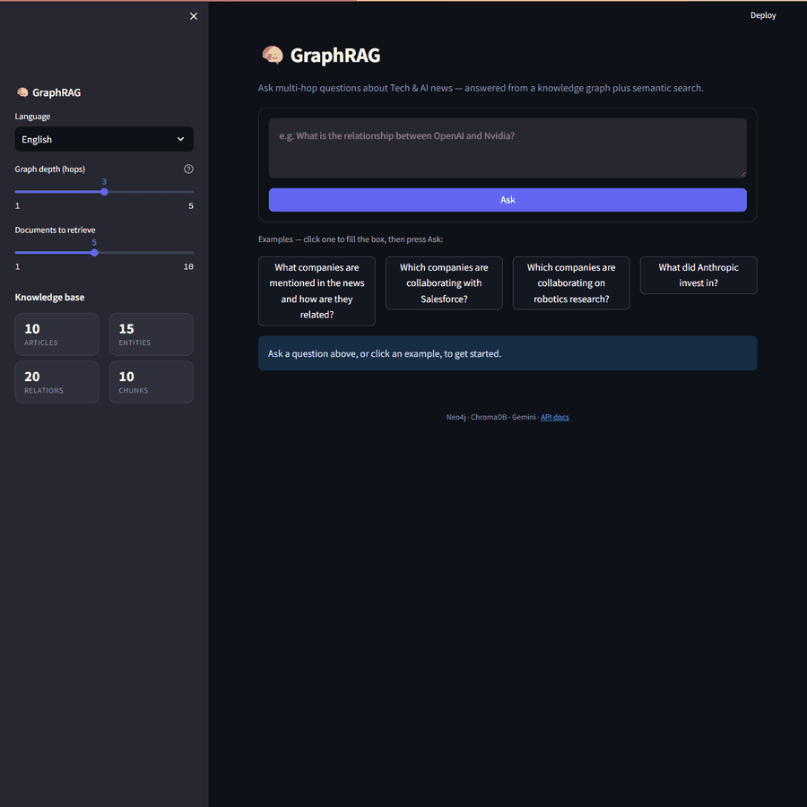
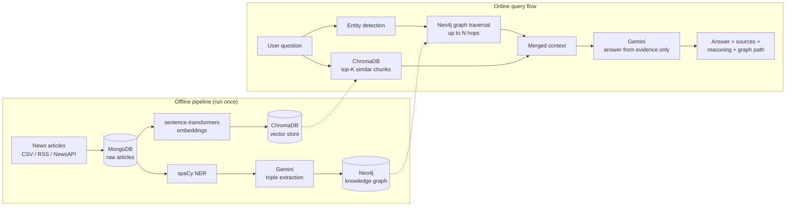

<div align="center">

# 🧠 GraphRAG for Multi-Hop Reasoning

**Ask questions whose answers are spread across several articles — get a grounded answer, its sources, and the graph path that connects the facts.**




</div>

GraphRAG combines a **knowledge graph (Neo4j)** with **vector search (ChromaDB)** and an LLM (**Google Gemini**), so facts from *different* documents can be chained together — something plain RAG cannot do.

## ✨ Key features

- **Multi-hop reasoning** — walks relationships in a Neo4j graph (configurable depth) to join facts across articles.
- **Hybrid retrieval** — graph paths for *how things connect* + vector search for *supporting text*.
- **Grounded answers** — Gemini answers only from retrieved evidence, and says so when the data is insufficient.
- **Explainable** — every answer ships with sources, reasoning steps, and an interactive graph of the path used.
- **Smart question linking** — spaCy NER plus matching against known graph entities, with a document-seeded fallback for topic questions.
- **Built-in evaluation** — benchmarks GraphRAG vs. standard RAG vs. a plain LLM ([results below](#-evaluation)).
- **Full stack** — FastAPI service, Streamlit UI, Docker Compose databases, multilingual answers and text-to-speech.

## The problem

Standard RAG retrieves text chunks that are *similar* to the question. It breaks when the answer needs facts joined from different documents:

- Article 1: *Google collaborated with Salesforce.*
- Article 2: *Salesforce collaborated with Hugging Face.*
- Question: *How is Google connected to Hugging Face?*

No single chunk says it. As a graph, the answer is a walk of two hops:

```
Google ──COLLABORATED_WITH──▶ Salesforce ──COLLABORATED_WITH──▶ Hugging Face
```

This project builds that graph from raw articles and walks it at query time. Each hop is one step along a relationship — hence **multi-hop reasoning**.

| Answer | Graph path |
|---|---|
|  |  |

## How it works



**Why both stores?** The graph shows *how things connect*; the vectors supply *the supporting text*. Together they give answers that are both connected and traceable.

## 📊 Evaluation

`evaluation/benchmark.py` answers the same 8 questions three ways — **GraphRAG**, **standard RAG** (vector search only) and a **plain LLM** (no retrieval) — and scores them against ground-truth answers.

**Headline metric: key-fact recall** — the share of required facts (company names, amounts) that appear in the answer. It is deterministic (no LLM involved).

| Key-fact recall | GraphRAG | Standard RAG | Plain LLM | Questions |
|---|:---:|:---:|:---:|:---:|
| **Overall** | **0.94** | 0.88 | 0.18 | 8 |
| Multi-hop questions | **0.90** | 0.80 | 0.28 | 5 |
| Single-hop questions | 1.00 | 1.00 | 0.00 | 3 |

What the numbers say:

- GraphRAG ≥ standard RAG on every question. The gap comes mostly from one question — *"Is Google connected to Hugging Face?"* — where vector search found no connecting document and answered "no information", while the graph found the link through Salesforce.
- GraphRAG is **not perfect**: on that same question it named Salesforce but missed the second connecting company (OpenAI), so it scored 0.5.
- The plain LLM scores near zero because the sample data is **synthetic** and not in its training data — expected, and a reminder that retrieval is what grounds the answers.

<details>
<summary><b>Caveats and the LLM-judge scores</b></summary>

- **Small and synthetic.** 8 questions over 10 generated articles. This demonstrates the method; it is not a statistically rigorous benchmark, and the gap over standard RAG is modest at this scale. Multi-hop advantages should grow with larger, denser graphs — but that is untested here.
- **LLM-judge score (secondary, noisy).** Gemini Flash-Lite also scored each answer 0–1 against the ground truth. Overall: GraphRAG 0.81, standard RAG 0.72, plain LLM 0.10. This judge is noisy: it scored GraphRAG's correct answer *"Anthropic invested $20 billion in Nvidia"* as 0.0 on every re-run while scoring the near-identical standard-RAG answer 1.0. That is why recall is the headline metric.
- **Judge prompt fixed after run 1.** My first run let the judge override the ground truth with real-world knowledge (it "knew" Anthropic never invested in Nvidia, which contradicts the synthetic data). I changed the prompt to treat the ground truth as authoritative and re-ran everything; the first run's file is kept as `evaluation/results_run1_unfair_judge.json` for transparency.
- Ground truth was written from the 10 loaded articles (`evaluation/questions.json`).

</details>

Reproduce (≈50 Gemini calls, ~7 minutes on the free tier):

```bash
python -m evaluation.benchmark            # run the benchmark -> evaluation/results.json
python -m evaluation.benchmark --rescore  # recompute key-fact recall from saved answers (no API calls)
```

## 💬 Example queries

| Question | Answer | How it was found |
|---|---|---|
| Which companies collaborate with Salesforce? | Google, OpenAI, Hugging Face, Cohere | Graph: Salesforce → Google → OpenAI → … + 5 supporting articles |
| Which company partners with Oracle and also collaborates with Salesforce? | Cohere | 2 hops: Oracle → Cohere → Salesforce |
| Is Google connected to Hugging Face? | Yes, via Salesforce | 2 hops: Google → Salesforce → Hugging Face |
| Which of Amazon's robotics partners also collaborate with each other? | AMD and Apple | Joint Amazon–AMD–Apple collaboration |
| Who did Anthropic invest in, and how much? | Nvidia, $20 billion | Single hop: Anthropic → INVESTED_IN → Nvidia |

## 🛠️ Tech stack

| Layer | Technology |
|---|---|
| **Frontend** | Streamlit, PyVis (vis.js) for the interactive graph, custom CSS |
| **Backend** | Python 3.11, FastAPI, Uvicorn, Pydantic |
| **Graph database** | **Neo4j 5** (Cypher, APOC) |
| **Vector database** | ChromaDB (cosine similarity) |
| **Document store** | MongoDB 7 |
| **LLM** | Google Gemini (triple extraction, answer generation, evaluation judge) |
| **NLP / embeddings** | spaCy `en_core_web_sm`, sentence-transformers `all-MiniLM-L6-v2` (384-d) |
| **Infra** | Docker Compose (MongoDB + Neo4j) |
| **Extras** | APScheduler, deep-translator (multilingual), gTTS (read answers aloud), Loguru, Tenacity, pytest |

## 🚀 Quick start

**Prerequisites:** Python **3.11**, Docker Desktop, and a free [Gemini API key](https://aistudio.google.com/apikey).
Python 3.12+ is not tested with the pinned dependencies (torch, chromadb).

```powershell
# 1. Start the databases
docker compose up -d mongodb neo4j

# 2. Create a virtual environment and install dependencies
python -m venv .venv
.venv\Scripts\Activate.ps1          # macOS/Linux: source .venv/bin/activate
pip install -r requirements.txt
python -m spacy download en_core_web_sm

# 3. Configure environment
copy .env.example .env              # then paste your GEMINI_API_KEY into .env

# 4. Make the project importable (needed for the scripts and Streamlit)
$env:PYTHONPATH = (Get-Location).Path     # macOS/Linux: export PYTHONPATH=$PWD

# 5. Verify everything is connected (expects 6/6 passing)
python test_connections.py

# 6. Build the knowledge base from the sample data
python scripts/run_pipeline.py --dataset ./data/sample_tech_news.csv --limit 10

# 7. Run the API and the UI (two terminals, each with PYTHONPATH set)
uvicorn app.api:app --host 127.0.0.1 --port 8000
streamlit run app/streamlit_app.py --server.port=8501
```

| What | URL |
|---|---|
| App (Streamlit UI) | http://localhost:8501 |
| API docs (Swagger) | http://localhost:8000/docs |
| Neo4j browser | http://localhost:7474 (`neo4j` / `graphrag_password`) |

```bash
# API example
curl -X POST http://localhost:8000/query -H "Content-Type: application/json" \
     -d '{"query": "Which companies are collaborating with Salesforce?"}'
```

**Using the UI:** type a question and press **Ask** (example buttons only fill the box). **Graph depth** sets how many hops are followed. Tabs: *Answer*, *Graph* (green node = starting entity), *Sources*, *Reasoning*. The sidebar shows how much data is loaded.

## 📁 Project structure

```
app/          FastAPI service (api.py) and Streamlit UI (streamlit_app.py)
ingestion/    Fetch and clean articles (CSV, RSS, NewsAPI, HackerNews)
extraction/   spaCy NER and Gemini triple extraction
graph/        Neo4j client and graph builder
vector/       Embeddings and ChromaDB client
retrieval/    Query entity detection, subgraph and vector retrieval
reasoning/    Multi-hop retrieval that merges graph and vector context
generation/   Gemini answer generation and result formatting
evaluation/   Benchmark (GraphRAG vs RAG vs LLM) and its question set
scripts/      Pipeline runner, sample-data generator, scheduler
config/       Settings (.env), logging, Pydantic models
tests/        Unit tests (pytest)
data/         Sample tech-news dataset (synthetic)
docs/         Screenshots and demo GIF
```

Common settings live in `.env` (see `.env.example`): `GEMINI_MODEL`, `GRAPH_TRAVERSAL_DEPTH` (default 3), `TOP_K_VECTOR` (default 5), `CHUNK_SIZE`, `GEMINI_MAX_CALLS_PER_RUN` (default 10 — raise it to ingest more articles per run).

## 🧪 Tests

```bash
pip install pytest
pytest tests/        # 7 unit tests: entity matching, chunk model, fact-recall scoring
```

## 🩺 Troubleshooting

| Symptom | Fix |
|---|---|
| `ModuleNotFoundError: reasoning` (or similar) | Set `PYTHONPATH` to the project root (quick-start step 4). |
| Dependency install fails (torch / chromadb wheels) | Use **Python 3.11**. Newer versions (e.g. 3.15) have no wheels for the pinned packages. |
| Docker: "Engine stopped" / `wsl` not installed (Windows) | Run `wsl --install --no-distribution` as Administrator, **restart**, then open Docker Desktop. |
| `404 model ... is no longer available` | Model names change. Set `GEMINI_MODEL` in `.env` to one your key can use. |
| `429` / quota errors | The free Gemini tier allows only a small number of requests per day, per model. Wait for the reset or switch `GEMINI_MODEL`. |
| Python crashes with *access violation* in ChromaDB | `onnxruntime` is too new — keep the `onnxruntime==1.17.1` pin from `requirements.txt`. |
| `pyarrow requires NumPy 2.0` | Keep the `pyarrow<16` pin from `requirements.txt` (the project pins NumPy 1.26). |
| Graph tab says no graph paths | The question didn't match anything in the graph. Name a company that is in the data, or load more articles with the pipeline. |
| Answer says "not enough information" | Expected for topics outside the loaded articles. |

## ⚠️ Limitations

- **Small, synthetic demo dataset:** 10 articles, 15 entities, 20 relationships. Questions outside it return "not enough information".
- **Extraction quality depends on the LLM.** Missed relationships are missing from the graph, and entity names are not fully de-duplicated.
- **Free Gemini tier is rate-limited**, so large ingestions are slow.
- **Graph paths follow links outward** from matched entities, so some returned paths are only loosely related.
- Local prototype: no authentication; databases run in local Docker containers.

## 🔭 Future work

- **Entity resolution** — merge "OpenAI" / "Open AI" / "OpenAI Inc." into one node.
- **Path ranking** — rank graph paths by relevance to the question and label edges in the graph view.
- **Scale** — a larger real dataset and a job queue for ingestion, then re-run the benchmark to see whether the multi-hop advantage grows.
